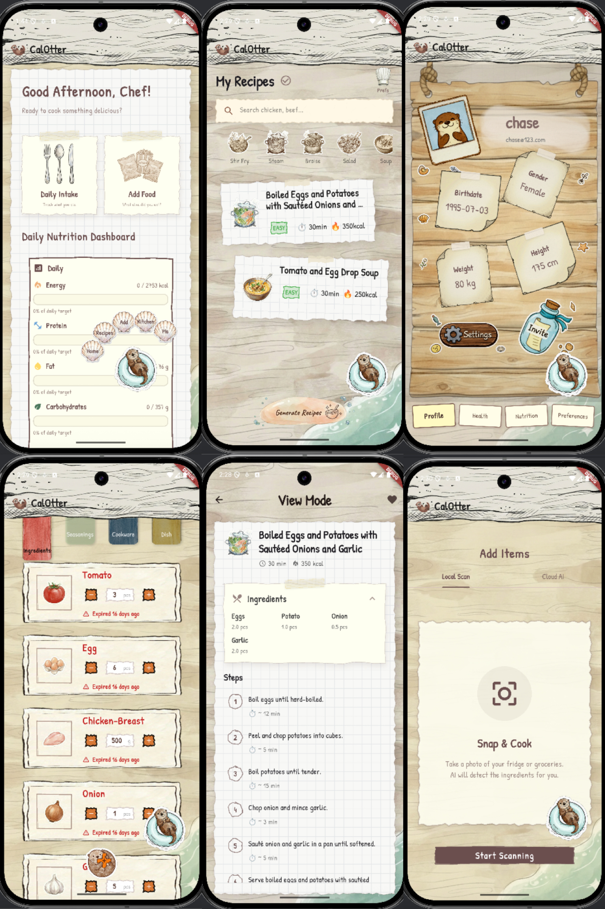
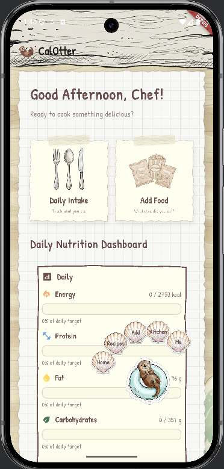

# Personal Sous Chef · Calotter

A mobile kitchen assistant that connects household food inventory, AI-assisted recipe planning, guided cooking, and nutrition tracking.

Originally developed as a University of Auckland COMPSCI 778 team project, this repository is being prepared for continued personal development and portfolio presentation. The existing application is a team contribution; it is not presented as a solo-built project. Team code and materials are published with permission.

**Status: development baseline.** Source and publication configuration have been inspected, but this copy has not yet been built or tested end to end. It is not ready for a public hosted service. The next milestones are reproducible setup, access-control fixes, and automated tests.

## Application scope

The codebase contains implementations for:

- **Household collaboration:** accounts, household membership, invitations, and shared kitchen inventory.
- **Food inventory:** ingredients, spices, utensils, leftovers, and stock deductions.
- **Recipe planning:** AI-assisted menu generation based on kitchen inputs and preferences.
- **Guided cooking:** recipe steps with voice and gesture interaction services.
- **Nutrition tracking:** food intake records, nutrition estimates, and daily summaries.
- **Ingredient recognition:** a bundled YOLO TensorFlow Lite model, with a separate cloud-recognition integration.

These describe the source implementation, not a claim that every feature or platform has passed validation. The screenshots below document the original project; runtime verification of this cleaned copy is still pending.

## Application screenshots

Extracted from the original internship final report (February 2026), Figures 7 and 8. These are historical project screenshots, not evidence of a successful build or end-to-end test of this repository version.

### Interface overview



From left to right: **dashboard, recipes, profile** (top row); **inventory, cooking instructions, ingredient scanning** (bottom row).

### Otter navigation and profile experience

<p align="center">
  
</p>

The report's **Frontend Integration: Profile UI and Navigational Components** section describes two related interface features:

- **Otter navigation:** a floating navigation component with tooltip bubbles, providing a consistent entry point to Home, Recipes, Add, Kitchen, and Me across features developed by different team members. The screenshot above shows the expanded navigation on the nutrition dashboard.
- **Passport-style profile:** a personal profile interface with custom page-flip animations and coordinated styling across Settings, Invite, and Edit Profile. It connects personal settings with shared-household settings. The profile screen appears in the top-right panel of the interface overview above.

These descriptions reflect the original report; interactions and animations still need verification in this repository version.

## Architecture

```text
Flutter mobile application
  ├── Local camera / voice / gesture services
  ├── Bundled YOLO TFLite ingredient recognition
  └── REST API
        └── Spring Boot modular backend
              ├── Users and households
              ├── Inventory
              ├── Cooking and recipe generation
              ├── Nutrition and intake
              ├── PostgreSQL
              └── Gemini / Groq integrations
```

The current client also contains a direct Gemini cloud-vision integration. Its embedded credential has been removed, so that fallback is disabled by default. Moving credential-bearing calls to the backend is planned.

| Layer | Technology |
| --- | --- |
| Mobile client | Flutter / Dart; pubspec requires Dart `^3.10.1` |
| Backend | Java 17, Spring Boot 3.2.0, Maven multi-module build |
| Persistence | Spring Data JPA / Hibernate, PostgreSQL 15 |
| AI integrations | Spring AI / Gemini, Groq |
| Local recognition | YOLO TFLite model, local `flutter_vision` package |
| Local infrastructure | Docker Compose for PostgreSQL |

## Repository layout

| Directory | Purpose |
| --- | --- |
| `frontend-app/` | Flutter application, assets, and local vision plugin |
| `backend-calotter/` | Backend modules, database seed data, and database Compose configuration |
| `yolo-training/` | Original training, inference, and validation scripts; optional for application use |
| `.github/workflows/deploy.yml.disabled` | Inactive legacy deployment workflow retained for reference |
| `PROJECT_OVERVIEW.md` | Detailed inherited architecture notes; some statements still need runtime verification |

## Local setup — not yet runtime-verified

These steps follow the current source configuration. They are a starting point for validation, not a tested quick start.

### Prerequisites

- Java 17 and Maven.
- Docker with Docker Compose.
- Flutter with a Dart version satisfying `^3.10.1`.
- The platform SDK and emulator or device for your chosen mobile target.
- Your own Gemini and Groq credentials for the corresponding AI features.

Platform folders are included, but feature support across Android, iOS, desktop, and web has not been verified. Camera, voice, gesture, and native model inference require device-specific validation. The Android wrapper scripts/JAR are absent from this snapshot and may need restoration before an Android build.

### 1. Configure the backend

From the repository root:

```bash
cd backend-calotter
cp env.template .env
```

Edit the local `.env` file and supply:

| Variable | Purpose |
| --- | --- |
| `DB_PASSWORD` | Local PostgreSQL password |
| `JWT_KEY` | Private signing value with at least 32 UTF-8 bytes; the current service reads the value as raw text |
| `GEMINI_API_KEY` | Backend Gemini integration |
| `GROQ_API_KEY` | Backend Groq integration |
| `GEMINI_PROJECT_ID` | Project identifier when required by your Gemini setup |

Do not commit `.env` or put real keys in source code. Existing credentials from the original project should be revoked or rotated by their owner if still active.

### 2. Start PostgreSQL

Still in `backend-calotter/`:

```bash
docker compose --env-file .env -f docker-compose.yml up -d
docker compose -f docker-compose.yml ps
```

The backend database is `calotter`, with user `postgres` on local port `5432`. Use a fresh development database for initial validation. The application uses Hibernate schema updates and runs `data.sql` on startup.

Use **this backend Compose file**. The repository-root Compose file is a legacy alternative with a different database configuration and a reference to a missing `database/init.sql` file.

### 3. Build and start the backend

From `backend-calotter/`:

```bash
mvn clean package
cd calotter-start
java -jar target/calotter-start-1.0.0-SNAPSHOT.jar
```

The existing dotenv initializer checks the working directory and its parent, allowing the backend `.env` to be found from `calotter-start/`. The configured HTTP port is `8080`.

A successful build is not proof of business-test coverage: application-level automated tests have not yet been added to this snapshot. Do not expose this backend to the public internet in its current authentication state.

### 4. Configure and run the client

In `frontend-app/lib/core/config/api_config.dart`, set `serverIp` to an address reachable from your emulator or device. The checked-in value is an inherited local-network address. For an Android emulator, the file documents `10.0.2.2`; physical devices need a reachable development-machine address.

From the repository root:

```bash
cd frontend-app
flutter pub get
flutter run
```

Keep `geminiApiKey` empty. Do not restore a private cloud key to the client source. Backend AI features use the backend credentials separately.

## Included model

The application loads `frontend-app/assets/models/yolo.tflite` and its `label.txt`. Both are included; the dataset and retraining are not needed to load this model.

The `yolo-training/` scripts are retained as background material. Their documentation mentions gesture training, whereas the application YOLO service performs ingredient recognition; the relationship needs clarification. The training script's old Roboflow credential has been replaced with a placeholder. No model accuracy, evaluation score, or device-performance claim is made here.

## Validation and next milestones

| Area | Current state / next step |
| --- | --- |
| Publication hygiene | Embedded credentials found during inspection removed; no local `.env`, Git history, or build caches included |
| Build and end-to-end flow | Not yet run on this cleaned copy |
| Authentication and authorization | Global security configuration permits requests; resource ownership checks need work |
| Audit identity | JPA auditing currently uses a fixed user ID |
| Tests | Existing Dart tests belong to the bundled plugin/examples; application business coverage is pending |
| CI / deployment | Legacy deployment is disabled; build/test CI is planned |
| Frontend configuration | Backend address is still hardcoded |
| Maintainability | Large page/service files will be refactored incrementally alongside tested changes |

The initial verification flow is: register/login → household → inventory → recipe generation → cooking completion → nutrition records. Further personal improvements will be documented with their scope and validation evidence, without attributing the original team's work to one person.

## Attribution and licensing

The original project was developed by the A-team for the COMPSCI 778 project. This personal continuation preserves that origin and the existing third-party notices.

- The bundled `flutter_vision` package retains its [MIT license](frontend-app/packages/flutter_vision/LICENSE).
- Bundled fonts retain their existing license files, including [Pangolin](frontend-app/font/Pangolin/OFL.txt), [Kalam](frontend-app/font/Pangolin/Kalam/OFL.txt), and [Patrick Hand](frontend-app/font/Pangolin/Patrick_Hand/OFL.txt).
- No repository-wide license has been selected for the application. Permission to publish this copy does not replace the terms applicable to third-party components.
